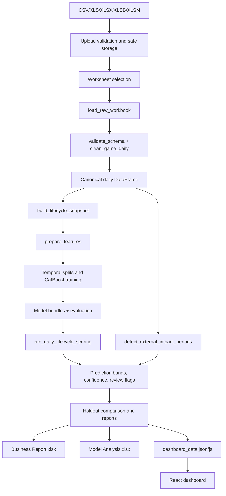

# Data Flow and Integrations

## End-to-end flow

## Data sources

1. User-uploaded workbooks stored in `data/uploads/`.
2. Optional notebook source workbook configured by `GAME_DATA_FILE`.
3. Existing model artifact `artifacts/models/training_results.joblib` when the
   score-only path is used.

There is no database, cloud object store, message broker, authentication
provider, or external API integration in the current implementation.

## Input validation layer

- Extension allow-list and file-name sanitisation occur before storage.
- Content-Length is required, consistent, positive, and at most 65 MB.
- Worksheet name is checked against the workbook’s actual sheets.
- Required source headers are canonicalised case-insensitively.
- Duplicate required headers are rejected.
- Dates are parsed with invalid values coerced to missing.
- Numeric text removes currency `R`, spaces, and thousands separators; percent
  text also removes `%` and converts decimal commas.
- Invalid dates, identifiers, numeric values, non-finite values, and negative
  activity rows are removed (or identifier errors can be configured to raise).

## Transformation logic

`clean_game_daily` creates:

- `Game_ID = SystemName + "::" + TournamentName`.
- `First_Observed_Date` per game.
- `Days_Since_First_Observed` as one-based lifecycle age.
- `GGR_Perc_Calc = GGR / Stakes` where stakes are non-zero.

`build_lifecycle_snapshot` creates point-in-time windows, weekly aggregates,
growth, ratios, log features, volatility, slope, recency, size bands, calendar
features, optional metadata, and future targets only when `require_future=True`.
Current scoring snapshots do not use future-derived target columns.

`modeling.py` trains regressors for commercial drivers and classifiers for client
and stakes high-performer targets. Outcomes are derived from drivers; prediction
intervals are fitted from out-of-fold residuals; probabilities may be isotonic
calibrated; thresholds are selected on validation data but never below the
configured minimum of 0.80 in production scoring.

## Storage mechanisms

| Location | Contents | Lifecycle |
|---|---|---|
| `data/uploads/` | Original uploaded workbooks | Retained until manually governed/removed. |
| `artifacts/processed/` | Canonical cleaned pickle | Latest successful pipeline publication. |
| `artifacts/features/` | Historical snapshot joblib | Latest successful pipeline publication. |
| `artifacts/models/` | Training results/model bundles | Latest successful production model. |
| `artifacts/reports/` | Notebook/report outputs | Manual or notebook-driven outputs. |
| `artifacts/uploads/<run_id>/` | Run-scoped cleaned data, models, predictions, logs, reports, dashboard data | Audit trail for a run. |
| `artifacts/dashboard/` | Published dashboard JSON/JS and compiled UI | Latest successful dashboard. |

Publication uses temporary files plus `os.replace` so consumers see a complete
artifact rather than a partially written file.

## Error handling

- Expected user/input errors return HTTP 400 with a useful message.
- Missing reports/uploads/statuses return 404.
- Unexpected server failures return 500 while printing a traceback-friendly
  message to the server terminal.
- Background jobs persist `queued`, `running`, `completed`, or `failed` state
  in memory and expose failure text through the status endpoint.
- Pipeline failures occur before publication where possible; staged dashboard
  files are only copied to the live location after the full run completes.

## Integration points

| Integration | Contract |
|---|---|
| Vite → Python API | `/api` and `/runs` proxy to `127.0.0.1:8000`. |
| Browser → upload API | Raw file bytes plus `X-File-Name` header. |
| Browser → run API | JSON body `{ "sheet_name": "..." }`. |
| Browser → status API | Poll by `job_id`. |
| Browser → dashboard data | JSON from `/api/dashboard-data`. |
| Browser → report download | XLSX from `/runs/{run_id}/business-report.xlsx` or `model-analysis.xlsx`. |
