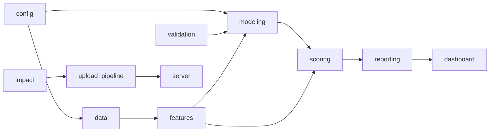

# Python Module Reference

The reusable package is in `src/game_performance/`. Each module has a
dedicated Markdown guide next to the source file.

| Module | Responsibility | Dedicated guide |
|---|---|---|
| `__init__.py` | Package identity/version | [__init__.md](../src/game_performance/__init__.md) |
| `config.py` | Settings, paths, defaults | [config.md](../src/game_performance/config.md) |
| `data.py` | Loading, schema validation, cleaning, quality | [data.md](../src/game_performance/data.md) |
| `features.py` | Lifecycle snapshots and model matrices | [features.md](../src/game_performance/features.md) |
| `validation.py` | Temporal splits, targets, metrics | [validation.md](../src/game_performance/validation.md) |
| `impact.py` | External-impact inference and flags | [impact.md](../src/game_performance/impact.md) |
| `modeling.py` | CatBoost training, tuning, evaluation, calibration | [modeling.md](../src/game_performance/modeling.md) |
| `scoring.py` | Current forecasts, confidence, review, recommendations | [scoring.md](../src/game_performance/scoring.md) |
| `reporting.py` | Holdout comparisons and Excel exports | [reporting.md](../src/game_performance/reporting.md) |
| `dashboard.py` | Dashboard dataset serialization | [dashboard.md](../src/game_performance/dashboard.md) |
| `upload_pipeline.py` | End-to-end upload orchestration | [upload_pipeline.md](../src/game_performance/upload_pipeline.md) |
| `server.py` | Local HTTP API and background jobs | [server.md](../src/game_performance/server.md) |
| `io.py` | Pickle/joblib persistence helpers | [io.md](../src/game_performance/io.md) |

## Dependency direction

