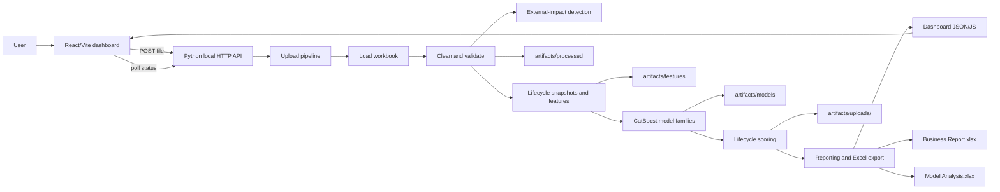
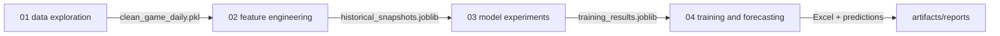

# Platform Overview

## Purpose

Game Performance ML turns daily game-level activity into operational forecasts
and prioritisation views. A user uploads a CSV or Excel worksheet, selects the
worksheet to score, and receives a seven-day forecast, holdout-quality
evidence, high-performer classifications, uncertainty/review flags, and
business/model-analysis workbooks.

## Business objectives

- Forecast near-term Clients, BetCount, Stakes, and GGR for each game.
- Separate demand/activity drivers from derived monetary outcomes so forecasts
  remain interpretable.
- Identify games likely to be high performers for clients and stakes.
- Highlight low-confidence or wide-interval forecasts for human review.
- Provide concise business outputs and a complete technical analysis workbook.
- Keep chronological evaluation leakage-safe: launch dates are split into
  training, validation, and holdout periods in order.

## Main capabilities

1. Workbook/CSV upload with safe file names, a 65 MB request limit, and sheet
   discovery.
2. Case-insensitive source-column validation and cleaning.
3. Lifecycle snapshot construction at checkpoints `(21, 28, 35, 42, 49, 56)`
   by default, with a seven-day forecast horizon.
4. Temporal model training with CatBoost regressors/classifiers, log transforms
   for non-negative targets, rolling validation, baseline blending, calibrated
   probabilities, and prediction intervals.
5. Daily lifecycle scoring for eligible games.
6. External-impact inference for metric spikes/drops versus recent medians.
7. Excel reports, dashboard JSON/JavaScript, and a React/Vite presentation.
8. Test coverage for data, features, validation, modeling, scoring, reporting,
   dashboard serialization, upload handling, and the background job lifecycle.

## High-level architecture



The Vite development server proxies `/api` and `/runs` to the Python API on
`127.0.0.1:8000`. In a static build, `artifacts/dashboard/index.html` reads the
published dashboard data generated by Python.

## Core workflows

### Interactive upload and production scoring

1. The user selects a supported CSV/Excel file.
2. The browser sends bytes to `POST /api/uploads`.
3. The server validates size and extension, sanitises the name, stores the
   upload under `data/uploads/`, and returns worksheet names.
4. The user selects a worksheet and posts `sheet_name` to
   `POST /api/uploads/{upload_id}/run`.
5. The server creates a background job and returns a `job_id`.
6. The browser polls `GET /api/runs/{job_id}` until completion or failure.
7. The pipeline cleans the sheet, detects impact periods, builds snapshots,
   trains production model families, scores eligible games, exports reports,
   stages dashboard data, and atomically publishes completed artifacts.
8. The dashboard reloads `/api/dashboard-data` and exposes report download links.

### Notebook lifecycle

The four notebooks are orchestration layers over the same package:



### Current scoring model

The preferred model forecasts commercial drivers:

```text
Clients
BetCount / Clients
Stakes / BetCount
GGR / Stakes
        ↓ derive
Clients, BetCount, Stakes, GGR
```

This allows the scoring layer to enforce non-negative activity quantities while
preserving signed GGR. Direct-outcome bundles remain scoreable for backward
compatibility.

## Roles and permissions

The current application has no authentication or multi-user authorization
layer. It is designed for local, trusted use. Operational roles are therefore
process roles rather than enforced application permissions:

| Role | Responsibilities |
|---|---|
| Business user | Upload valid source data, choose the right worksheet, inspect forecasts and review flags, download reports. |
| Analyst | Validate inputs, interpret holdout metrics, investigate impact periods, and communicate recommendations. |
| Support engineer | Start the services, inspect job/API failures, preserve logs, and verify artifacts. |
| Developer/data scientist | Change modules, notebooks, model settings, tests, and report schemas while preserving compatibility. |
